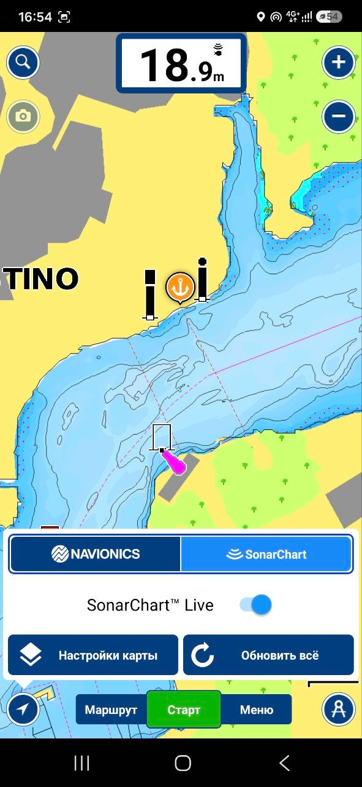
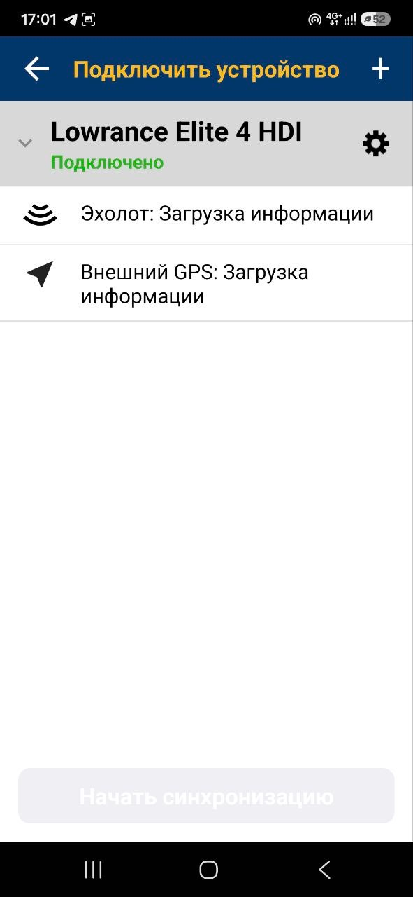

# NMEA Wi-Fi Bridge

**Передавай данные с эхолота или картплоттера на телефон или планшет по Wi-Fi.**

Это небольшой самодельный проект для тех, кому хочется использовать данные бортового оборудования на мобильных устройствах — без дополнительного кабеля от эхолота к телефону.

Я сделал мост для своей лодки и решил поделиться результатом. Возможно, он пригодится и другим водномоторникам и рыбакам.

## Что умеет устройство

- Получает данные NMEA 0183 от эхолота или картплоттера.
- Передаёт эти данные по Wi-Fi на телефон или планшет.
- Позволяет использовать совместимые навигационные приложения, которые умеют принимать данные от внешних источников.
- Работает в локальной сети — подключение к интернету и облачным сервисам для передачи данных не требуется.
- Может использоваться вместе с уже установленным бортовым оборудованием.

## Зачем это нужно на воде

**Карта отдельно — эхолот отдельно.** Даже если эхолот умеет показывать навигационные карты, необязательно занимать ими его экран. Пусть он целиком показывает эхограмму, рыбу и структуру дна, а карта с текущей глубиной будет на телефоне или планшете. Не придётся жертвовать полезной площадью дисплея эхолота ради разделённого экрана.

**Большой планшет для подробной батиметрии.** Рассматривать густую сеть изобат, свалы, бровки и мелкие особенности рельефа удобнее на большом экране. Особенно когда хочется спокойно изучить участок или смотреть, как SonarChart Live рисует новые глубины во время движения.

**Текущая глубина прямо на карте.** На экране телефона или планшета можно видеть не только своё положение, но и глубину, которую в данный момент измеряет эхолот. Удобно, когда карта открыта на большом экране и хочется следить за изменением глубин, не переключаясь постоянно между устройствами.

**Собственные карты глубин с SonarChart Live.** В Navionics Boating можно включить SonarChart Live: приложение получает промеры от эхолота и во время движения лодки рисует новые изобаты поверх карты. Пройденные участки сохраняются, так что к собранным данным можно вернуться в следующую поездку.

Это особенно интересно рыбакам. Готовые карты глубин полезны, но не всегда достаточно подробны или актуальны: в реках перемещаются песчаные косы и наносы, в водохранилищах меняется уровень воды, а некоторые участки могли быть промерены давно или слишком редко. Свои измерения помогают лучше изучить конкретное место, заметить свалы, бровки и другие особенности рельефа, которые могут быть важны при поиске рыбы.

Сам мост не рисует карты: он передаёт данные с эхолота, а отображением глубины и построением изобат занимается совместимое навигационное приложение.

> **Важно:** показания эхолота и SonarChart Live зависят от настроек датчика, уровня воды и качества промеров. Созданные изобаты не заменяют официальные навигационные карты, визуальное наблюдение и осторожность на воде.

## Что уже проверено

Основная функция передачи данных работает. Проверена связка с эхолотом Lowrance Elite-4 HDI и приложением Navionics Boating на Android.

Подключение к существующей сети Wi-Fi работает. Режим, в котором само устройство создаёт точку доступа, пока экспериментальный и требует дальнейшей проверки, особенно с устройствами Apple.

Совместимость с другими эхолотами, картплоттерами, телефонами и навигационными приложениями ещё предстоит проверить.

## Фото и видео работы

Вот как это выглядит при работе с Navionics Boating. Мост передаёт данные эхолота, а приложение показывает глубину на карте и позволяет пользоваться SonarChart Live.

| Глубина и SonarChart Live | Подключение эхолота |
|:---:|:---:|
|  |  |
| Текущая глубина и построение своих изобат прямо на карте. | Приложение получает данные от подключённого эхолота. |

🎬 **[Посмотреть видео работы NMEA Wi-Fi Bridge](media/nmea-wifi-bridge-demo.mp4)** — примерно минута, без звука.

*Скриншоты из Navionics Boating приведены для демонстрации совместимости и работы моста. Navionics и SonarChart Live принадлежат своим правообладателям; этот любительский проект не связан с Garmin/Navionics.*

## Веб-интерфейс и приложение для Android

**Веб-интерфейс моста доступен в обычном браузере** на телефоне, планшете или компьютере, подключённом к той же сети. Через него можно открыть настройки устройства — устанавливать отдельное приложение для этого не нужно.

Есть и небольшое [приложение NMEA Bridge Android](https://github.com/zoychikf1/NMEA-Bridge-Android): оно помогает найти мост в локальной сети и сразу открыть его веб-интерфейс.

**Приложение полностью бесплатное, без подписок.** Это просто удобный дополнительный способ доступа. Оно **не требуется ни для работы моста, ни для его настройки**: всё можно сделать и без него, через браузер. Навигационное приложение, поддерживающее подключение к мосту, получает данные независимо от NMEA Bridge Android.

## Это любительский проект

Устройство сделано энтузиастом для себя и таких же любителей водномоторной техники. Проект развивается постепенно, поэтому документация и возможности будут дополняться по мере испытаний.

Это не сертифицированное морское оборудование. Не полагайтесь на него как на единственный источник навигационной информации или средство обеспечения безопасности.

## Есть опыт использования?

Буду рад узнать, получилось ли у вас подключить мост к своему оборудованию. Особенно интересны модели эхолотов и картплоттеров, навигационные приложения и результаты испытаний на реальных лодках.

Замечания, вопросы и предложения приветствуются!

---

*Сделано для своей лодки. Делюсь, чтобы пригодилось и другим.*
