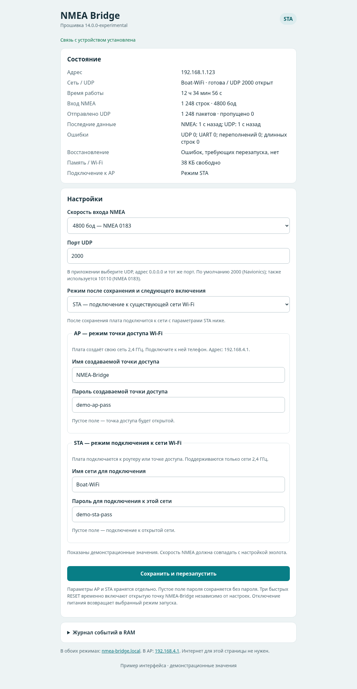
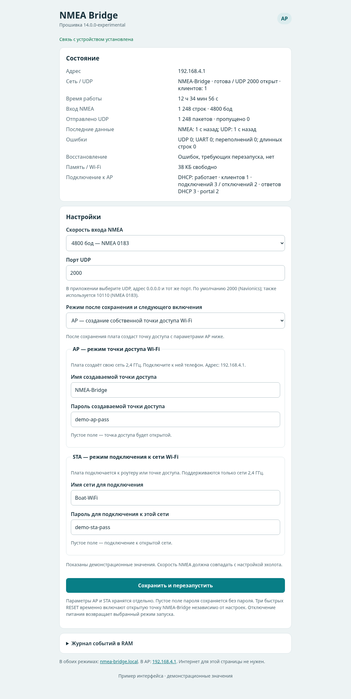
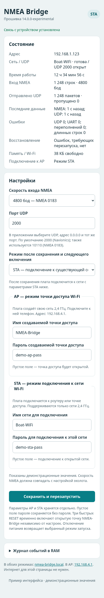

# Веб-интерфейс NMEA Bridge

Веб-интерфейс встроен в прошивку NMEA Bridge. Он нужен для двух вещей: посмотреть, что происходит с устройством прямо сейчас, и изменить его настройки. Отдельная программа на телефоне или компьютере для этого не требуется — достаточно браузера.

Страница открывается локально. Интернет, облачный аккаунт и внешний сервер не нужны. Интерфейс адаптируется к ширине экрана: им можно пользоваться и с компьютера, и со смартфона. Внешние библиотеки и ресурсы не загружаются. Форма настроек работает и без JavaScript; если JavaScript включён, панель состояния автоматически обновляется примерно раз в три секунды.

> **О скриншотах.** Изображения ниже показывают внешний вид интерфейса прошивки 14.0.0-experimental. Адреса, имена сетей, пароли, счётчики и время работы на них демонстрационные: на реальном устройстве будут отображаться его собственные настройки и текущие показатели.

## Как открыть страницу

Веб-интерфейс доступен в обоих режимах Wi-Fi:

- **STA — подключение к существующей сети:** откройте в браузере `http://nmea-bridge.local/`. Если имя не разрешается на вашем устройстве, используйте IP-адрес моста, показанный в панели состояния или в списке клиентов роутера.
- **AP — собственная точка доступа:** подключитесь к Wi-Fi сети, созданной мостом, и откройте `http://192.168.4.1/`. Имя сети и пароль задаются в настройках моста. Если телефон не открыл страницу автоматически, введите адрес вручную.

Имя `nmea-bridge.local` поддерживается и в STA, и в AP. В режиме AP дополнительно работает локальная страница-переход для captive portal: некоторые телефоны предлагают открыть её автоматически после подключения к точке доступа.

Интернет для доступа к настройкам не требуется. Важно лишь, чтобы телефон, планшет или компьютер был подключён к той же локальной сети, что и мост.

## Режимы Wi-Fi

Мост работает в одном из двух режимов — STA или AP. Это два альтернативных способа подключить телефон или планшет к устройству.

### STA — подключение к существующей сети

Мост подключается к роутеру или мобильной точке доступа, а телефон или планшет подключается к той же сети. Адрес устройству выдаёт DHCP-сервер роутера, поэтому конкретный IP может отличаться от поездки к поездке.

Этот вариант удобен, если на лодке уже есть свой Wi-Fi роутер или если для подключения используется точка доступа телефона. Для работы самого моста интернет не нужен: сеть используется как локальный канал связи между эхолотом, мостом и навигационным приложением.

Поддерживаются сети Wi-Fi **2,4 ГГц**. Сеть только 5 ГГц не подойдёт.

### AP — собственная точка доступа моста

Мост сам создаёт Wi-Fi сеть. К ней подключается телефон или планшет, после чего веб-интерфейс доступен по адресу `http://192.168.4.1/`.

Это удобно, когда на лодке нет отдельного роутера. При этом телефон оказывается подключён к сети моста, у которой нет выхода в интернет. Поведение мобильного интернета при таком подключении зависит от телефона и его настроек: не стоит рассчитывать, что он всегда останется доступен одновременно с подключением к AP моста.

В обычном режиме AP имя сети и пароль можно изменить в веб-интерфейсе. Если пароль оставить пустым, точка доступа будет открытой.

## Панель «Состояние»

Верхняя карточка показывает текущий режим и диагностические показатели. Значения обновляются автоматически примерно раз в три секунды.

| Поле | Что означает |
|---|---|
| **Адрес** | Текущий IP-адрес моста. В STA он обычно назначается роутером, в AP используется адрес `192.168.4.1`. Здесь же отображается состояние mDNS. |
| **Сеть / UDP** | Имя активной Wi-Fi сети, состояние сетевого соединения, выбранный UDP-порт и информация о том, открыт ли UDP-сокет. В AP дополнительно показывается число подключённых клиентов. |
| **Время работы** | Время с момента последнего запуска или перезапуска платы. |
| **Вход NMEA** | Количество принятых строк NMEA и текущая скорость последовательного порта. |
| **Отправлено UDP** | Количество отправленных UDP-пакетов и число строк, которые не удалось передать. В обычном режиме каждая завершённая строка NMEA отправляется отдельным UDP-пакетом. |
| **Последние данные** | Сколько секунд назад была принята последняя строка NMEA и отправлен последний UDP-пакет. Помогает понять, поступают ли данные прямо сейчас. |
| **Ошибки** | Счётчики ошибок отправки UDP, ошибок UART, переполнений приёма и слишком длинных строк NMEA. |
| **Восстановление** | Текущее состояние механизмов восстановления: например, ожидание восстановления Wi-Fi или UDP, восстановление точки доступа либо отсутствие ошибок, требующих перезапуска. Также показывается число перезапусков SoftAP. |
| **Память / Wi-Fi** | Объём свободной оперативной памяти ESP8266. В режиме STA дополнительно показывается уровень Wi-Fi-сигнала в dBm. |
| **Подключение к AP** | В режиме AP показывает состояние DHCP, число подключённых клиентов, количество подключений и отключений, ответы DHCP и обращения к captive portal. В режиме STA здесь отображается сам режим STA. |

Счётчики помогают не гадать, работает ли связка. Например:

- если растёт число принятых строк NMEA, но не растёт число UDP-пакетов, стоит посмотреть счётчик ошибок UDP;
- если оба счётчика не меняются, проверьте источник NMEA, проводку и скорость обмена;
- если время последнего NMEA обновляется, а время последнего UDP — нет, проблема находится на этапе сетевой отправки;
- если в AP число клиентов равно нулю, телефон или планшет сейчас не подключён к сети моста.

Сами счётчики и время работы относятся к текущему запуску и сбрасываются после перезагрузки.

## Карточка «Настройки»

Настройки собраны в одной форме. Профили AP и STA отображаются одновременно, поэтому можно заранее заполнить параметры обеих сетей и выбрать, в каком режиме мост должен запускаться.

### Скорость входа NMEA

Доступны два значения:

- **4800 бод** — стандартная скорость NMEA 0183;
- **38400 бод** — NMEA 0183-HS.

Скорость должна совпадать с настройкой выхода NMEA на эхолоте или картплоттере. Если значения различаются, корректный приём данных не гарантируется. Изменение применяется после сохранения и перезапуска моста.

### Порт UDP

Здесь задаётся порт, на который мост отправляет UDP-пакеты. По умолчанию используется **2000** — он подходит для проверенной связки с Navionics Boating.

Также можно использовать **10110** — стандартный порт NMEA 0183 для сетевой передачи. Если навигационное приложение требует другой порт, укажите его здесь и задайте тот же порт в приложении.

В навигационном приложении выберите приём данных по UDP, адрес `0.0.0.0` и тот же номер порта, который указан в настройках моста.

Допустимый диапазон — 1–65535, кроме портов, занятых служебными сетевыми механизмами самого устройства.

### Режим после сохранения и следующего включения

Здесь выбирается, как мост должен подключаться к Wi-Fi:

- **STA** — подключаться к уже существующей сети;
- **AP** — создавать собственную точку доступа.

После сохранения мост перезапустится и перейдёт в выбранный режим. Это не переключатель мгновенного перехода без перезапуска.

### AP — режим точки доступа Wi-Fi

Эта группа задаёт параметры сети, которую создаёт сам мост:

- **Имя создаваемой точки доступа** — название Wi-Fi сети, которое будет видно в списке сетей телефона или планшета;
- **Пароль создаваемой точки доступа** — пароль для подключения к ней.

Если оставить пароль пустым, точка доступа будет открытой. Для обычного использования лучше задать пароль и подключать только свои устройства.

### STA — подключение к сети Wi-Fi

Эта группа задаёт параметры сети, к которой должен подключиться мост:

- **Имя сети для подключения** — SSID роутера или точки доступа телефона;
- **Пароль для подключения к этой сети** — пароль этой сети.

Если сеть открытая, поле пароля можно оставить пустым. Поддерживаются только сети 2,4 ГГц.

### Сохранение

Кнопка **«Сохранить и перезапустить»** записывает настройки и перезапускает мост. Обычно через несколько секунд устройство появится в выбранном режиме.

Профили AP и STA хранятся отдельно: изменение параметров одной сети не стирает настройки другой. Параметры сохраняются во flash-памяти; обычное открытие страницы и просмотр статуса ничего не записывают.

Если форма сообщает об ошибке, проверьте выбранный режим, скорость NMEA, имя сети, пароль и UDP-порт. Для паролей Wi-Fi допускается пустое значение, стандартная длина 8–63 символа или 64 шестнадцатеричных символа.

## Журнал событий

В нижней части страницы находится сворачиваемый блок **«Журнал событий в RAM»**. В нём хранятся последние 24 события: запуск устройства, подключение к Wi-Fi, открытие UDP-порта, начало приёма NMEA, подключения клиентов и другие диагностические сообщения.

- Журнал находится в оперативной памяти, а не во flash.
- После перезапуска он очищается.
- Когда записей становится больше 24, самые старые заменяются новыми.
- Ссылка **«Открыть свежий журнал целиком»** открывает текстовый снимок текущего журнала по адресу `/logs`. Просмотр не очищает журнал.

Журнал особенно полезен, если мост не подключается к роутеру, телефон не может получить адрес от точки доступа или UDP-передача не запускается.

## Восстановление доступа

Если сохранённые настройки Wi-Fi мешают подключиться к мосту, предусмотрен отдельный режим восстановления.

Три быстрых аппаратных нажатия RESET подряд, в коротком окне после каждого запуска, принудительно включают открытую точку доступа **NMEA-Bridge**. Она временно игнорирует сохранённое имя и пароль AP. Подключитесь к ней и откройте `http://192.168.4.1/`.

В этом режиме на странице появляется дополнительное сообщение о том, что запущена точка восстановления. Сохранение настроек и перезапуск выводят устройство из режима восстановления и запускают выбранный режим. Обычное выключение и повторное включение питания также возвращает сохранённый режим запуска.

### Автоматическое восстановление

Прошивка следит за состоянием Wi-Fi и UDP и пытается восстановить работу без ручного вмешательства.

- В STA потеря Wi-Fi-соединения с IP-адресом запускает таймер на 120 секунд. Если сеть не восстановилась, устройство перезапускается.
- При устойчивой ошибке отправки UDP используется отдельный таймер на 60 секунд. Успешная отправка снимает его.
- В AP при отсутствии подключённых клиентов в течение пяти минут выполняется перезапуск точки доступа и UDP. Если клиентов нет десять минут, перезапускается сама плата. Подключение клиента сбрасывает этот таймер.
- Если точку доступа не удаётся запустить, прошивка повторяет попытки и перезапускает устройство после 60 секунд неудачного восстановления.

Текущее состояние этих механизмов отражается в строке **«Восстановление»**.

## Безопасность и важные замечания

Веб-интерфейс предназначен для локальной сети лодки, а не для публикации в интернете. Сейчас он работает по обычному HTTP, без HTTPS и отдельной авторизации пользователя. Не настраивайте проброс его HTTP-порта на внешний адрес роутера и не подключайте мост к недоверенной сети.

Пароли Wi-Fi в форме отображаются обычным текстом — так устроен текущий интерфейс. Любой человек, имеющий доступ к веб-странице, сможет увидеть сохранённые значения. Поэтому используйте доверенную локальную сеть и пароль точки доступа, если AP не должна быть открытой.

## Скриншоты интерфейса

### STA — подключение к существующей сети

### AP — собственная точка доступа

### Мобильная версия

